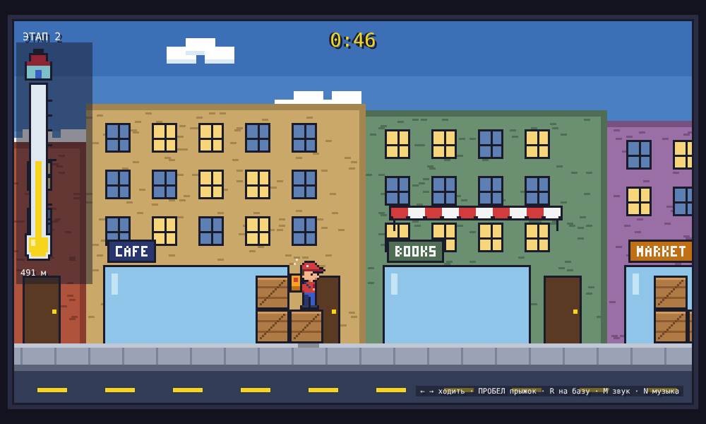
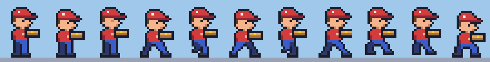

# Доставка за 5 минут

Пиксельная аркада про курьера, который развозит пиццу. Чистый HTML, CSS и JavaScript, без сборки и зависимостей.

## Запуск

Открой `index.html` в браузере (двойной клик).

## Управление

| Действие | Клавиатура | Телефон |
|---|---|---|
| Ходить | ← → или A D | кнопки ◀ ▶ |
| Прыжок | Пробел, ↑, W или Z | кнопка A |
| Вернуться на базу | R | кнопка R |
| Звук вкл/выкл | M | — |
| Музыка вкл/выкл | N | кнопка ♪ |

Чем дольше держишь прыжок, тем выше прыгает курьер. Можно прыгнуть сквозь навес снизу и встать на него.

В начале улицы стоит пиццерия, единственная в городе: это база курьера и контрольная точка. Рядом с дверью флажок с кусочком пиццы. Если уйти далеко и вернуться, флажок радостно машет и появляется надпись «КОНТРОЛЬНАЯ ТОЧКА». Клавиша R в любой момент возвращает курьера к пиццерии.

## Этапы

- [x] **Этап 1.** Курьер с пиццей ходит и прыгает по улице: ящики, навесы, параллакс-город, пиццерия-контрольная точка.
  - Звук: фоновая чиптюн-мелодия (пульс-лид, треугольный бас, барабаны), шаги в такт анимации ног, прыжок, приземление, торможение. Всё синтезируется в браузере, файлов со звуком нет.
  - Анимация курьера: цикл шага из 4 кадров с качанием корпуса, дыхание и моргание в покое, взлёт, падение, приземление с приседом, торможение с разворотом. Пицца едет в термосумке-рюкзаке, из неё идёт пар, свободная рука качается в такт шагу.

  
- [ ] Этап 2. …

## Файлы

| Файл | Что внутри |
|---|---|
| `index.html` | Разметка, экран заставки, кнопки для телефона |
| `style.css` | Стили, пиксельный шрифт, масштабирование |
| `js/audio.js` | Звуковые эффекты и фоновая музыка (Web Audio) |
| `js/sprites.js` | Спрайты курьера с рюкзаком, нарисованные текстом |
| `js/game.js` | Уровень, физика, управление, звук, отрисовка |
